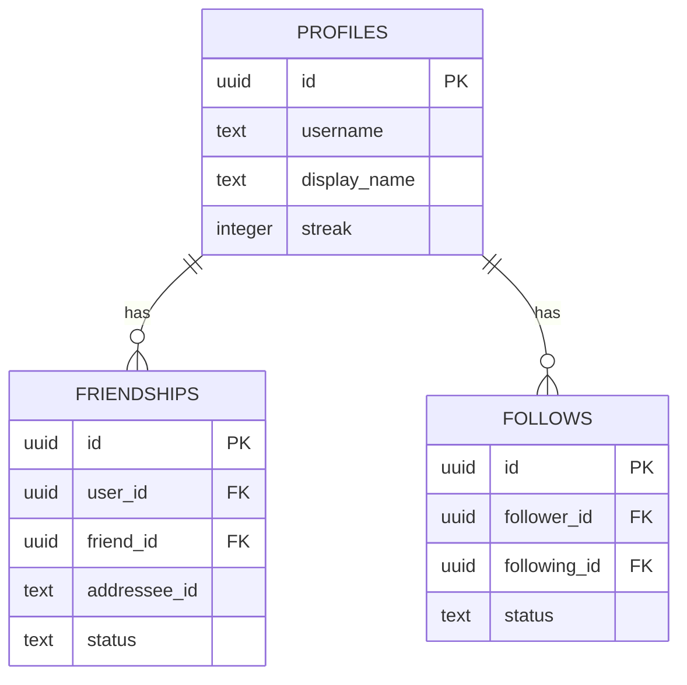

# ДИАГНОСТИЧЕСКИЙ ОТЧЁТ: СИСТЕМА ДРУЗЕЙ И СОРАТНИКОВ (FRIENDS SYSTEM)
> **Файл:** `diagnostics/DIAG_04_FRIENDS_SYSTEM.md`  
> **Дата аудита:** 9 ноября 2026 г.  
> **Роль:** Старший Full-Stack инженер и аудитор  
> **Статус:** ТОЛЬКО ДИАГНОСТИКА (код не изменялся, миграции не применялись)

---

## 1. Архитектура и терминология: «Соратники», «Друзья», «Подписки»

В текущей версии интерфейса обнаружена терминологическая путаница:
- В боковом меню и виджете правого рейла используется термин **«Соратники»** (`ActiveFriendsWidget`, `components/ogonek/active-friends-widget.tsx`).
- В шапке менеджера используется заголовок **«Круг соратников»**, а на табах написано **«Друзья»** и **«Подписки»** (`components/ogonek/friends-manager.tsx:348-372`).
- В модели данных сосуществуют понятия `friendIds` (взаимные друзья) и `followingIds` (односторонние подписки). При этом в базе данных одновременно создаются таблицы `public.friendships` и `public.follows`.

---

## 2. Как сейчас устроено добавление в друзья

### 2.1. Ссылка-приглашение (Invite Link) — КРИТИЧЕСКИЙ БАГ
1. **Генерация ссылки (`lib/ogonek/profile-share.ts:187-194`)**:
   ```ts
   export function buildInviteUrl(username: string): string {
     const handle = (username || 'friend').replace(/^@/, '')
     const origin = typeof window !== 'undefined' && window.location?.origin
       ? window.location.origin
       : 'https://ogonek.cernavation.com'
     return `${origin}/invite/${handle}`
   }
   ```
2. **Поведение кнопки «Пригласить» (`components/ogonek/friends-manager.tsx:253-262`)**:
   - Пользователь нажимает кнопку «Пригласить».
   - Копируется строка вида `https://ogonek.app/invite/username`.
   - Появляется Toast: `Ссылка-приглашение скопирована — отправь её другу`.
3. **Что происходит при переходе по ссылке (ФАКТ ПО КОДУ)**:
   - В каталоге `app/` маршрут `app/invite/` **НЕ СУЩЕСТВУЕТ**.
   - Нет ни `app/invite/[username]/page.tsx`, ни редиректа в `middleware.ts`.
   - Друг, открывший ссылку в Telegram/браузере, попадает на **страницу 404 (Not Found)** (`app/not-found.tsx`).
   - **Вывод:** механизм приглашения друзей по ссылке полностью сломан.

### 2.2. Поиск по нику в `FriendsManager`
1. Поле ввода в `FriendsManager` (`components/ogonek/friends-manager.tsx:45-53`):
   ```ts
   function matches(friend: FriendProfile, query: string): boolean {
     if (!query) return true
     const q = query.trim().toLowerCase()
     return (
       friend.name.toLowerCase().includes(q) ||
       friend.username.toLowerCase().includes(q) ||
       friend.city.toLowerCase().includes(q)
     )
   }
   ```
2. **Как наполняется список соратников (`friends-manager.tsx:184-219`)**:
   - При монтировании компонент вызывает `getRecentProfiles(40, profile.username)` (`lib/supabase/api.ts:189`).
   - Загружаются **первые 40 пользователей** из базы Supabase.
   - Поле поиска осуществляет **локальную фильтрацию строго по этим 40 пользователям**!
   - Если пользователь ищет никнейм друга, которого нет в первой сороковке недавних профилей, поиск выдаёт `fm-empty` («Никого не найдено»).
   - Сетевой запрос поиска `searchProfiles(query)` из `FriendsManager` **НЕ ВЫЗЫВАЕТСЯ**.

### 2.3. Поиск по нику в `ExploreView`
1. В разделе «Поиск / Сообщество» строка поиска (`components/ogonek/explore/explore-search-bar.tsx:13`) действительно вызывает `searchProfiles(term)`.
2. Однако найденный результат открывает модалку `CommunityUserModal`, где доступна кнопка **«Читать» (Follow)**, но нет понятного действия «Добавить в соратники» с отправкой заявки.

---

## 3. Модель данных и синхронизация социального графа



### 3.1. Несогласованность схемы БД
1. **Схема `SUPABASE_FULL_SCHEMA.sql:450-454`**:
   - `addressee_id text not null check (char_length(addressee_id) between 1 and 120)`
   - `status text not null check (status in ('friend', 'following', 'incoming-request', 'outgoing-request', 'dismissed'))`
2. **Миграция `SUPABASE_2.0_MIGRATION.sql:363-365`**:
   - `user_id uuid REFERENCES public.profiles(id)`
   - `friend_id uuid REFERENCES public.profiles(id)`
   - `addressee_id uuid REFERENCES public.profiles(id)`
   - `status text NOT NULL DEFAULT 'following'`
3. **Код API `lib/supabase/api.ts:448-485` (`followUser`)**:
   - Отправляет:
     ```ts
     await supabase.from('friendships').upsert({
       user_id: followerId,
       friend_id: followingId,
       addressee_id: followingId,
       status: 'accepted', // <-- НЕДОПУСТИМЫЙ СТАТУС В СХЕМЕ 1.0!
     })
     ```
   - Одновременно делает upsert в таблицу `follows`:
     ```ts
     await supabase.from('follows').upsert({
       follower_id: followerId,
       following_id: followingId,
       status: 'accepted',
     })
     ```

### 3.2. Кэш в памяти (`lib/ogonek/friends.ts`)
- Список профилей кэшируется в переменной модуля `const profileCache = new Map<string, FriendProfile>()` (`lib/ogonek/friends.ts:40`).
- Массив `FRIEND_PROFILES` пуст (`lib/ogonek/friends.ts:37`).
- **Следствие:** При жесткой перезагрузке страницы (F5) `profileCache` очищается. Массив `state.friendIds` в `localStorage` содержит ID друзей, но функция `getFriend(id)` возвращает `undefined`. В результате список друзей отображается **пустым** до тех пор, пока фоновый запрос не переполнит кэш.

---

## 4. Статусы заявок и уведомления

| Действие | Что происходит в коде | Что видит второй пользователь | Статус доставки |
|:---|:---|:---|:---:|
| **Отправка заявки в друзья** | `useOgonekStore:sendFriendRequest` пишет ID в `state.outgoingFriendRequests`. Вызывает `followUser` в Supabase со статусом `accepted`. | **НИЧЕГО НЕ ВИДИТ.** Входящие заявки (`incomingFriendRequests`) у второго пользователя не обновляются. | **СЛОМАНО** |
| **Уведомление о заявке** | Уведомление в базе **не создаётся**. Таблицы `notifications` в схеме нет. | Колокольчик/бейдж не загорается. Таб «Заявки» показывает 0. | **ОТСУТСТВУЕТ** |
| **Realtime-подписка на заявки** | Подписка на изменение заявок в друзья отсутствует в `app-shell.tsx`. | Второй пользователь узнает о дружбе только если случайно сам подпишется в ответ. | **ОТСУТСТВУЕТ** |

---

## 5. Права доступа к постам (Лично / Друзьям / Публично)

В приложении заявлены три уровня видимости (`lib/ogonek/visibility.ts:32-60`):
1. `'public'` — «Публично в глобальную ленту»
2. `'friends'` — «Только друзьям»
3. `'private'` — «Лично для меня»

### 5.1. Как приватность проверяется на самом деле

1. **В ленте `HomeView` (`components/ogonek/views/home-view.tsx:132-160`)**:
   - Лента **НЕ запрашивает посты друзей из Supabase**.
   - Фильтр `filter === 'Друзья'` работает строго по локальному массиву `state.days`:
     ```ts
     return days.filter((d) => {
       const uid = d.user_id || (d as any).userId
       if (!uid) return false
       if (isMine) return false
       return followingIds.includes(uid)
     })
     ```
   - Записи других пользователей могут оказаться в `days` только если они были загружены из общего демо-файла `seeds/ogonek-import.v1.json` или если синхронизация выкачала чужие записи.
2. **В API-запросе `getUserPublicDays` (`lib/supabase/api.ts:1185-1204`)**:
   ```ts
   export async function getUserPublicDays(userId: string, isFriend: boolean = false): Promise<PublicDayRecord[]> {
     let q = supabase.from('days').select('...').eq('user_id', userId)
     if (isFriend) {
       q = q.in('visibility', ['public', 'friends'])
     } else {
       q = q.eq('visibility', 'public')
     }
     ...
   }
   ```
   **Уязвимость:** параметр `isFriend` передаётся **клиентом**! Клиент сам сообщает серверу, считает ли он себя другом целевого пользователя.
3. **На уровне базы данных (PostgreSQL RLS)**:
   - В `SUPABASE_2.0_MIGRATION.sql:424` и `disable_days_rls.sql:6` RLS на таблицах `days`, `prides`, `gratitudes` **полностью отключён**.
   - Любой аутентифицированный или анонимный клиент с ключом `anon` может выполнить прямой SQL/PostgREST запрос:
     ```js
     await supabase.from('days').select('*, prides(*)').eq('visibility', 'private')
     ```
     и получить все скрытые записи любого пользователя без каких-либо ограничений!

---

## 6. UX-проблемы: почему пользователю непонятно, как добавить друга

1. **Менеджер друзей спрятан глубоко в профиле**:
   Чтобы найти список соратников, нужно: открыть «Профиль» → нажать «Ещё» → проскроллить вниз до табов → выбрать таб «Друзья» → нажать «Управление соратниками». В главном меню отдельного пункта «Друзья» нет.
2. **Кнопка «Пригласить» бесполезна**:
   Пользователь нажимает «Пригласить», получает ссылку, отправляет товарищу. Товарищ кликает и видит 404. Возникает ощущение, что сервис не работает.
3. **Поле поиска не ищет новых людей**:
   Пользователь вводит точный никнейм друга в строку «Поиск по имени, @нику или городу» в менеджере друзей. Если друга нет среди 40 недавно зарегистрированных, поиск выдаёт «Никого не найдено». Пользователь уверен, что друга нет в системе.
4. **Асимметрия без обратной связи**:
   Пользователь нажимает «Добавить в друзья». Кнопка меняется на «В друзьях». Но у второго пользователя ничего не происходит: ни уведомления, ни входящей заявки. Дружба остаётся односторонней.

---

## 7. Граничные случаи и уязвимости логики

1. **Самозапрос (Self-friendship)**:
   В методе `followUser` (`lib/supabase/api.ts:443`) отсутствует проверка `followerId !== followingId`. Пользователь может отправить запрос самому себе, подписаться на себя и искусственно накрутить счётчики взаимности.
2. **Дублирование связей в двух таблицах**:
   Связи пишутся одновременно в `public.friendships` и `public.follows`. При ошибке сети в одном из запросов таблицы расходятся. `getProfileFollowers` пытается читать из `friendships` с колонкой `friend_id`, затем с `addressee_id`, а затем падает в `follows` (`lib/supabase/api.ts:305-342`).
3. **Удаление друга (Orphaned Relations)**:
   При отписке `unfollowUser` удаляет запись, где `user_id = followerId`. Если дружба была взаимной, у второго пользователя запись остаётся активной. Полноценного двустороннего разрыва дружбы нет.
4. **Отсутствие блокировок (Blocking)**:
   В системе нет таблицы `blocks` и механизма чёрного списка. Нельзя запретить нежелательному пользователю подписываться или писать сообщения.
