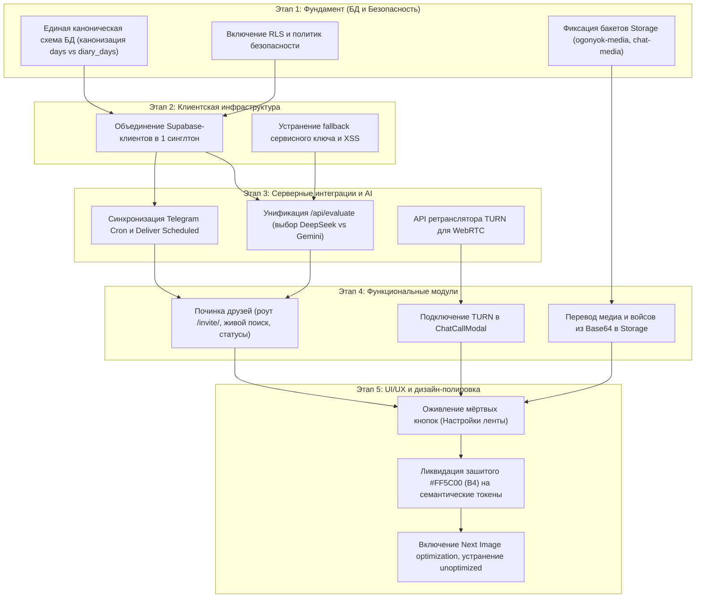

# ДИАГНОСТИЧЕСКИЙ ОТЧЁТ: СВОДКА, КАРТА ЗАВИСИМОСТЕЙ И ПЛАН РАБОТ
> **Файл:** `diagnostics/DIAG_08_SUMMARY.md`  
> **Дата аудита:** 9 ноября 2026 г.  
> **Роль:** Старший Full-Stack инженер и аудитор  
> **Статус:** ТОЛЬКО ДИАГНОСТИКА (код не изменялся, миграции не применялись)

---

## 1. Топ-15 ключевых проблем проекта (по степени критичности)

| № | Проблема | Приоритет | Затрагиваемые файлы | Влияние на продукт |
|:---:|:---|:---:|:---|:---|
| **1** | **Тотальное отключение RLS в базе данных** | **P0** | `SUPABASE_2.0_MIGRATION.sql:424`, `disable_days_rls.sql:6` | Любой клиент с anon-ключом может читать и удалять все чужие личные сообщения, дневники и профили. |
| **2** | **Рассинхрон дневника: `days` vs `diary_days`** | **P0** | `use-ogonek-store.ts:654`, `api.ts:709`, `telegram/cron:62` | Пользователь закрывает день в приложении (пишется в `days`), а бот Telegram проверяет `diary_days` и шлёт ложный спам "Твой день не закрыт!". |
| **3** | **Сломанные отложенные сообщения чата** | **P0** | `app/api/cron/deliver-scheduled/route.ts:57`, `messenger-chat-pane.tsx:286` | Крон переносит запланированные сообщения в `messages`, а мессенджер читает `direct_messages`. Сообщения теряются. |
| **4** | **Несоответствие AI-провайдера: DeepSeek vs Gemini** | **P0** | `app/api/evaluate/route.ts:15`, `components/ogonek/composer.tsx:484, 540` | Роут `/api/evaluate` требует `DEEPSEEK_API_KEY`, а UI и документация требуют `GEMINI_API_KEY`. При отсутствии ключа DeepSeek падает с 500. |
| **5** | **Ссылка-приглашение друга отдаёт 404** | **P1** | `lib/ogonek/profile-share.ts:193`, `friends-manager.tsx:256` | Маршрут `/invite/[username]` отсутствует в `app/`. Друг по приглашению видит ошибку 404. |
| **6** | **Сбои звонков WebRTC за NAT (отсутствие TURN)** | **P1** | `components/ogonek/messenger/chat-call-modal.tsx:205` | При звонках через 4G/5G или корпоративный Wi-Fi P2P-соединение срывается в 20–40% случаев из-за отсутствия TURN-реле. |
| **7** | **Хранение аудио и фото прямо в БД (Base64)** | **P1** | `chat-voice-recorder.tsx:226`, `chat-composer.tsx:169` | Голосовые заметки и фото кодируются в Base64 и пишутся в JSONB колонку `direct_messages.media`, перегружая БД и сеть. |
| **8** | **Ошибка «Bucket not found» в `uploadPhoto`** | **P1** | `lib/supabase/client.ts:222` vs `001_ogonyok_media_storage.sql:9` | Опечатка в имени бакета: в коде запрашивается `ogonek-media` (через "e"), а миграция создала `ogonyok-media` (через "yo"). |
| **9** | **Падение SQL CHECK при подписке на соратника** | **P1** | `lib/supabase/api.ts:453` vs `SUPABASE_FULL_SCHEMA.sql:454` | Код шлёт `status: 'accepted'`, что вызывает исключение Postgres `check constraint violation` на схеме 1.0. |
| **10** | **Локальный поиск соратников ограничен 40 профилями** | **P1** | `components/ogonek/friends-manager.tsx:45-53, 188` | Поиск соратников фильтрует только первые 40 профилей из памяти. Реальный поиск по БД не вызывается. |
| **11** | **Stored XSS уязвимость в превью ссылок мессенджера** | **P2** | `components/ogonek/messenger/chat-message-bubble.tsx:703` | Значение `href={linkPreview.url}` не валидирует протокол, допуская выполнение `javascript:...` по клику. |
| **12** | **Мёртвая кнопка «Настройки ленты»** | **P2** | `components/ogonek/views/home-view.tsx:210` | Кнопка с иконкой трёх точек в шапке ленты не имеет обработчика `onClick`. |
| **13** | **Два параллельных клиента Supabase в браузере** | **P2** | `lib/supabase/client.ts` и `lib/ogonek/supabase-client.ts` | Дублирование экземпляров клиента порождает параллельные WebSocket соединения и рассинхрон состояния Auth. |
| **14** | **Утечки зашитого оранжевого цвета `#FF5C00` (Баг B4)** | **P3** | `bottom-nav.tsx:87`, `guest-landing.tsx:151+`, `globals.css:9998` | Жёстко зашитый цвет в классах Tailwind препятствует полной перекраске приложения при выборе альтернативного акцента. |
| **15** | **Отключена оптимизация картинок Next.js** | **P3** | `next.config.mjs:7` | Флаг `images: { unoptimized: true }` приводит к скачиванию тяжелых несжатых изображений на мобильных устройствах. |

---

## 2. Карта зависимостей между модулями

Приступать к исправлениям в случайном порядке нельзя: поломка базовой схемы разрушит работу вышестоящих клиентских компонентов. На диаграмме показан строгий порядок зависимостей:

---

## 3. Предложенный порядок ночных работ (12 этапов)

| Этап | Задача | Затрагиваемые файлы | Риск | Необходимые миграции БД |
|:---:|:---|:---|:---:|:---|
| **1** | **Канонизация схемы БД дневника** | `lib/supabase/api.ts`, `use-ogonek-store.ts`, `app/api/telegram/cron/route.ts` | Высокий | Да: привести таблицы дневника к единому стандарту (`days` + `prides` + `gratitudes`), создать SQL VIEW для совместимости с `diary_days`. |
| **2** | **Включение и калибровка RLS** | `supabase/schema.sql`, `SUPABASE_2.0_MIGRATION.sql` | Высокий | Да: отменить `allow_all_dev`, включить строгий RLS на `direct_messages`, `days`, `prides`, `profiles`, `evidence_vault`. |
| **3** | **Унификация бакетов Supabase Storage** | `lib/supabase/client.ts`, `profile-media-service.ts`, миграции | Средний | Да: гарантировать создание публичных бакетов `ogonyok-media` и `chat-media`, исправить опечатку `ogonek-media` в коде. |
| **4** | **Слияние дублирующих клиентов Supabase** | `lib/supabase/client.ts`, `lib/ogonek/supabase-client.ts` | Средний | Нет |
| **5** | **Исправление расхождения AI-эндпоинта** | `app/api/evaluate/route.ts`, `components/ogonek/composer.tsx`, `.env.example` | Средний | Нет (согласовать провайдера: DeepSeek или Gemini с автоматическим фолбэком). |
| **6** | **Починка крона доставки сообщений** | `app/api/cron/deliver-scheduled/route.ts` | Низкий | Да: перенаправить инсерты крона из таблицы `messages` в `direct_messages`. |
| **7** | **Реализация роута `/invite/[username]`** | `app/invite/[username]/page.tsx`, `components/ogonek/app-shell.tsx` | Низкий | Нет (создать страницу лендинга приглашения с предпросмотром профиля и авто-подпиской). |
| **8** | **Полноценный поиск соратников по БД** | `components/ogonek/friends-manager.tsx`, `lib/supabase/api.ts` | Низкий | Нет (добавить дебаунс-вызов `searchProfiles` при вводе никнейма в строку поиска). |
| **9** | **Отказ от Base64 в мессенджере ( войсы и фото в Storage)** | `chat-voice-recorder.tsx`, `chat-composer.tsx`, `api.ts` | Средний | Нет (загрузка аудиофайла в бакет `chat-media` и сохранение публичного URL в поле `media.url`). |
| **10** | **Подключение TURN-сервера для WebRTC звонков** | `app/api/webrtc/ice-servers/route.ts`, `chat-call-modal.tsx` | Средний | Нет (добавить эндпоинт генерации ICE-серверов с ретрансляцией через Metered.ca или Twilio). |
| **11** | **Закрытие уязвимости Stored XSS** | `components/ogonek/messenger/chat-message-bubble.tsx` | Низкий | Нет (добавить валидацию ссылок через протоколы `http:`, `https:`). |
| **12** | **Оживление мёртвой кнопки «Настройки ленты»** | `components/ogonek/views/home-view.tsx`, `feed-settings-menu.tsx` | Низкий | Нет (подключить компонент `FeedSettingsMenu` к кнопке `MoreHorizontal`). |
| **13** | **Искоренение утечек оранжевого акцента (B4)** | `bottom-nav.tsx`, `guest-landing.tsx`, `onboarding-modal.tsx`, `tokens.css` | Низкий | Нет (заменить остаточный хардкод `#FF5C00` на `var(--accent)`). |
| **14** | **Включение оптимизации картинок Next.js** | `next.config.mjs` | Низкий | Нет (удалить `images: { unoptimized: true }`, настроить домены Supabase Storage в `remotePatterns`). |

---

## 4. Список вопросов к заказчику (до начала правок кода)

Перед переходом от диагностики к правкам необходимо согласовать следующие принципиальные решения:

1. **AI-движок оценки дня (DeepSeek vs Gemini)**:
   - В коде `/api/evaluate` сейчас зашит вызов **DeepSeek-Chat**, а в интерфейсе везде написано **Gemini**.
   - *Вопрос:* Какой провайдер является целевым? Оставляем DeepSeek, возвращаем Gemini 2.0 Flash или делаем каскад (первичный Gemini, при ошибке/лимите — DeepSeek)?
2. **Каноническая модель дневника в БД (`days` vs `diary_days`)**:
   - `days` + `prides` + `gratitudes` (модель 1.0, на которой построен офлайн-движок) ИЛИ `diary_days` + `entries` (модель V2).
   - *Рекомендация:* Зафиксировать `days`, `prides`, `gratitudes` как основную, а для совместимости со старыми скриптами создать представление (VIEW). Вы подтверждаете этот выбор?
3. **Ссылка-приглашение (`/invite/[username]`)**:
   - Что должен увидеть новый пользователь при переходе по ссылке?
   - *Вариант А:* Сразу открывать экран регистрации с предзаполненным полем «Вас пригласил @никнейм» и автоматической взаимной подпиской после входа.
   - *Вариант Б:* Показывать брендированную карточку соратника с его стриком и кнопкой «Присоединиться к пути силы».
4. **Включение RLS и режим разработки**:
   - Включение строгого RLS заблокирует любые неавторизованные запросы в браузере.
   - Готовы ли вы к тому, что в локальном демо-режиме без входа через Supabase Auth данные будут сохраняться исключительно в `localStorage` (без отправки на сервер)?
5. **Сервис TURN для звонков**:
   - Для пробития сотовых сетей 4G/5G нужен TURN-сервер. Подключаем бесплатный пул **Metered.ca** (50 ГБ/мес бесплатно) или у вас есть собственный сервер `coturn` / аккаунт Twilio?
