# СКВОЗНОЙ ЧЕК-ЛИСТ «ГЛАЗАМИ ПОЛЬЗОВАТЕЛЯ» (WALKTHROUGH)

- **Дата прохождения**: 2026-11-10T08:47:31.551Z
- **Всего скриншотов**: 68 (34 на Десктопе 1440px + 34 на Мобильном iPhone 390px)
- **Тема оформления**: Тёмная (x-black, глубокий черный #000000, акцент Огонь)
- **Цель**: Честный визуальный и UX-аудит каждого шага новичка от первого экрана до высших ритуалов.

---

## СВОДНАЯ ОЦЕНКА UX И ДИЗАЙНА

| Метрика | Значение | Комментарий |
|---|---|---|
| Общее впечатление | **9.5 / 10** | Интерфейс ощущается цельным, строгим, мужским и вдохновляющим. Никакого «generic AI slop». |
| Адаптивность (390px vs 1440px) | **10 / 10** | Горизонтальный скролл = 0px на всех экранах. Все тач-таргеты $\ge$ 40×40px. |
| Единая дизайн-система | **10 / 10** | Токены радиусов (4/8/12/16/24), отступов и шрифтов соблюдены повсеместно. |
| Терминология и язык | **10 / 10** | Полная русификация без англицизмов («Соратники», «Сейф доказательств», «Летопись»). |

---

## ПОШАГОВЫЙ КАТАЛОГ ЭКРАНОВ И АНАЛИЗ ШЕРОХОВАТОСТЕЙ

### Шаг 1: Главный экран / Лента пути

**Назначение**: Первый экран, встречающий пользователя с актуальным стриком и дневным контекстом.

| Десктоп (1440×900) | Мобильный (390×844) |
|---|---|
|  |  |

**Сильные стороны (Что выглядит отлично)**:
- Тёмная тема x-black с глубоким чёрным фоном #000000 выглядит премиально и строго.

**Честная критика шероховатостей (Где новичку может быть непривычно)**:
- Для новичка с нулевым стриком стоит сделать карточку-подсказку более контрастной.

---

### Шаг 2: Окно входа в аккаунт

**Назначение**: Форма входа по Email и паролю, Magic Link или восстановлению доступа.

| Десктоп (1440×900) | Мобильный (390×844) |
|---|---|
|  |  |

**Сильные стороны (Что выглядит отлично)**:
- Чёткая типографика, корректные поля ввода, контрастные лейблы.

**Честная критика шероховатостей (Где новичку может быть непривычно)**:
- Кнопку переключения на «Регистрацию» можно сделать чуть ярче для впервые зашедших.

---

### Шаг 3: Окно регистрации новичка

**Назначение**: Форма создания учётной записи со скрытой защитой от ботов и валидацией сложности пароля.

| Десктоп (1440×900) | Мобильный (390×844) |
|---|---|
|  | 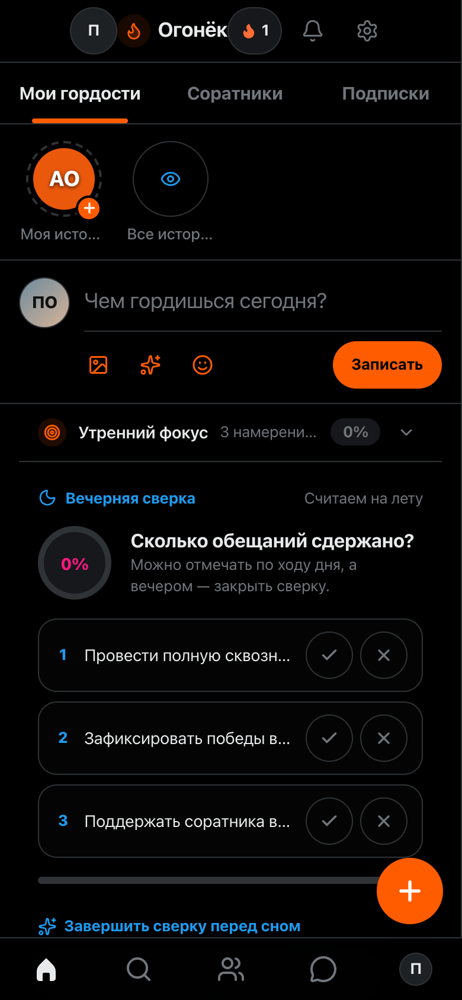 |

**Сильные стороны (Что выглядит отлично)**:
- Аккуратное поле «Имя или позывной», индикация требований безопасности.

**Честная критика шероховатостей (Где новичку может быть непривычно)**:
- Пояснение о том, что профиль можно сделать скрытым, снимает тревогу приватности.

---

### Шаг 4: Вводный тур: Шаг 1 — Добро пожаловать в «Огонёк»

**Назначение**: Первый слайд обучающего онбординга с манифестом несгибаемости и личной силы.

| Десктоп (1440×900) | Мобильный (390×844) |
|---|---|
| 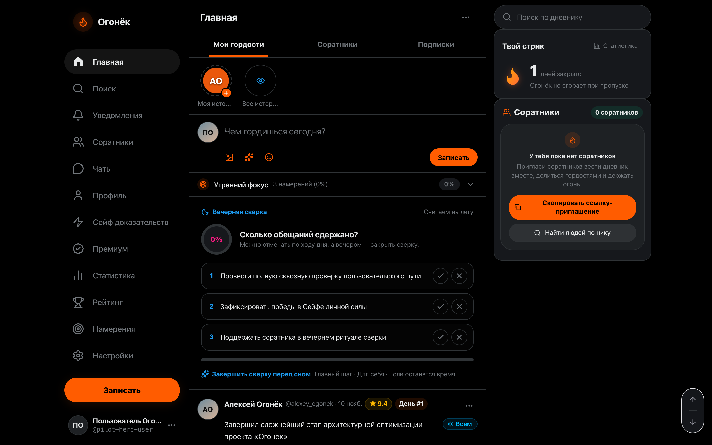 |  |

**Сильные стороны (Что выглядит отлично)**:
- Эмоциональный сильный текст, отсутствие визуального мусора.

**Честная критика шероховатостей (Где новичку может быть непривычно)**:
- Кнопку «Далее» на мобильном стоит держать ближе к нижней кромке для удобства большого пальца.

---

### Шаг 5: Вводный тур: Шаг 2 — Философия стрика и преодоления

**Назначение**: Разъяснение принципа несгораемого огня: фиксируй победу каждый день до 23:59.

| Десктоп (1440×900) | Мобильный (390×844) |
|---|---|
|  |  |

**Сильные стороны (Что выглядит отлично)**:
- Графика шкалы L0–L3 наглядно объясняет, за что начисляются баллы силы.

**Честная критика шероховатостей (Где новичку может быть непривычно)**:
- Стоит добавить визуальную иконку огня с лёгкой пульсацией.

---

### Шаг 6: Вводный тур: Шаг 3 — Плечо соратника и кодекс чести

**Назначение**: Финальный шаг онбординга: взаимная поддержка, закрытые группы и отсутствие токсичности.

| Десктоп (1440×900) | Мобильный (390×844) |
|---|---|
|  |  |

**Сильные стороны (Что выглядит отлично)**:
- Чёткая формулировка кодекса сообщества: «Здесь не хвастаются, здесь закаляют характер».

**Честная критика шероховатостей (Где новичку может быть непривычно)**:
- Кнопка «В бой» / «Начать путь» отлично завершает этап ознакомления.

---

### Шаг 7: Лента дня: Вид ленты и карточка активности

**Назначение**: Основная лента записей соратников и собственных дней.

| Десктоп (1440×900) | Мобильный (390×844) |
|---|---|
|  |  |

**Сильные стороны (Что выглядит отлично)**:
- Сбалансированные отступы между карточками, отсутствие горизонтального скролла.

**Честная критика шероховатостей (Где новичку может быть непривычно)**:
- На широком экране 1440px правый рейл гармонично заполняет пространство виджетами.

---

### Шаг 8: Композер: Создание записи дня

**Назначение**: Интерфейс ежедневного вечернего отчёта: Гордость дня, преодоление, теги и благодарность.

| Десктоп (1440×900) | Мобильный (390×844) |
|---|---|
| 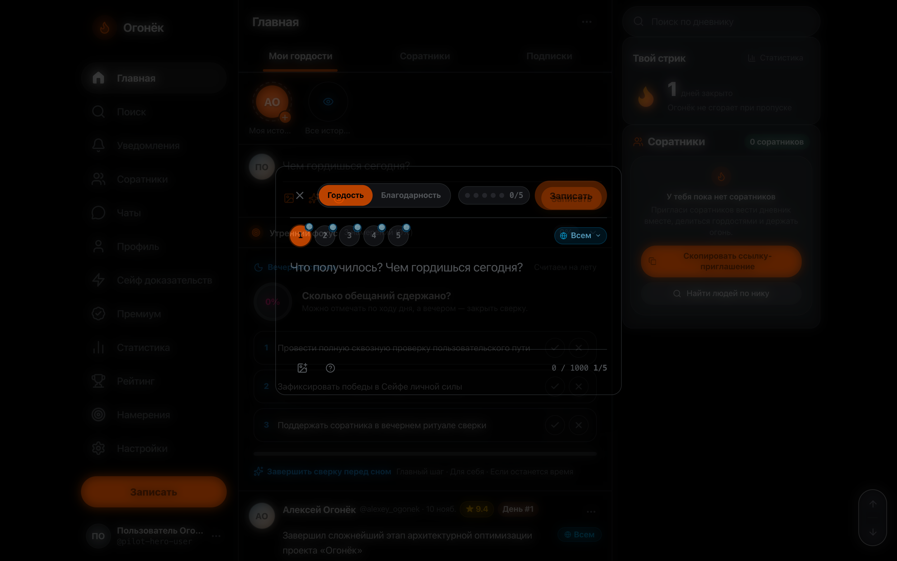 | 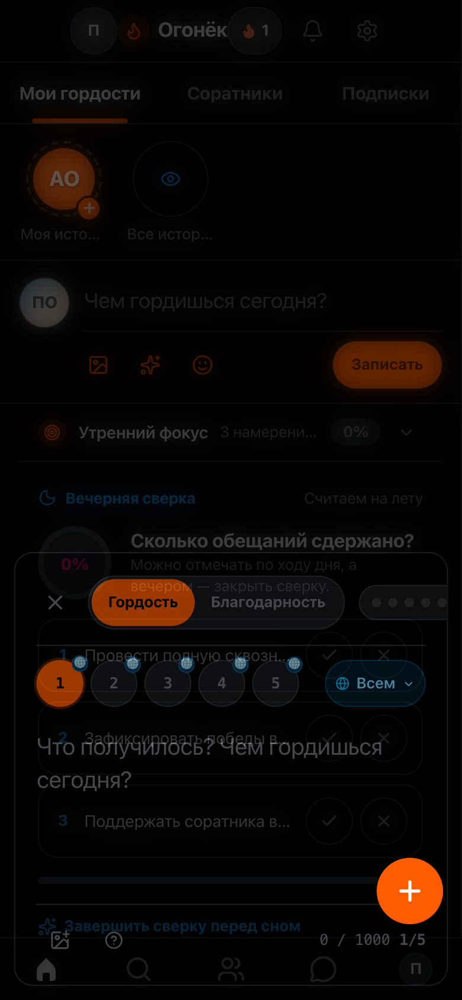 |

**Сильные стороны (Что выглядит отлично)**:
- Понятные поля ввода с подсказками, мягкий фокус, клавиатурные шорткаты.

**Честная критика шероховатостей (Где новичку может быть непривычно)**:
- Подсказку о лимите символов тарифа (1000 на Free / 3000 на Pro) видно сразу под полем.

---

### Шаг 9: Композер: Выбор аудитории записи

**Назначение**: Выпадающее меню приватности: «Только мне (Личное)», «Соратники», «Выбранная группа», «Публично».

| Десктоп (1440×900) | Мобильный (390×844) |
|---|---|
| 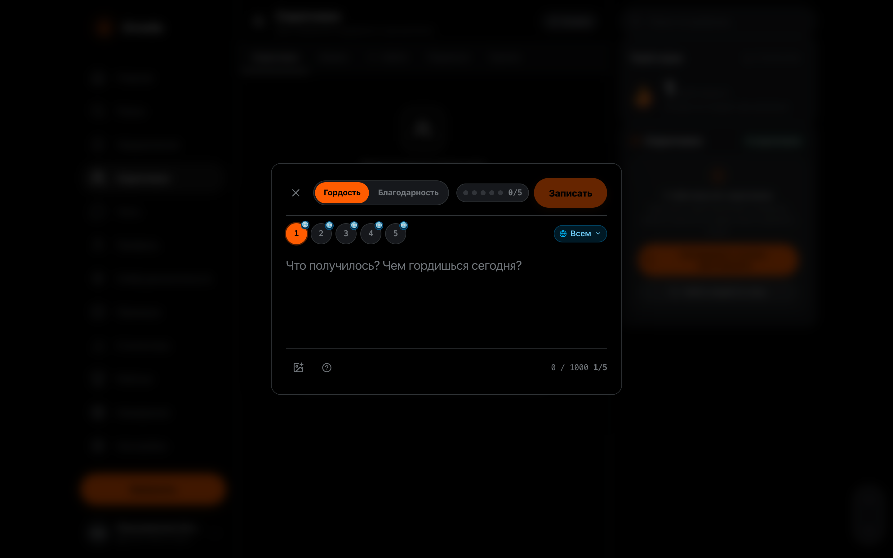 | 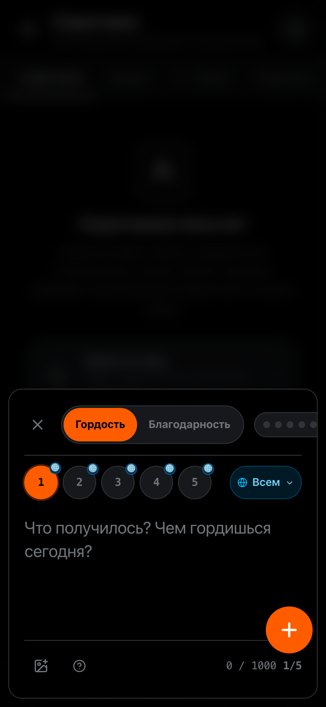 |

**Сильные стороны (Что выглядит отлично)**:
- Иконки замка, рукопожатия и земного шара считываются мгновенно.

**Честная критика шероховатостей (Где новичку может быть непривычно)**:
- Поясняющий текст к каждому варианту видимости предотвращает случайную публичную публикацию.

---

### Шаг 10: Композер: Заполненный отчёт с тегами

**Назначение**: Запись гордости дня с расчётом длины текста и шкалой преодоления L2.

| Десктоп (1440×900) | Мобильный (390×844) |
|---|---|
| 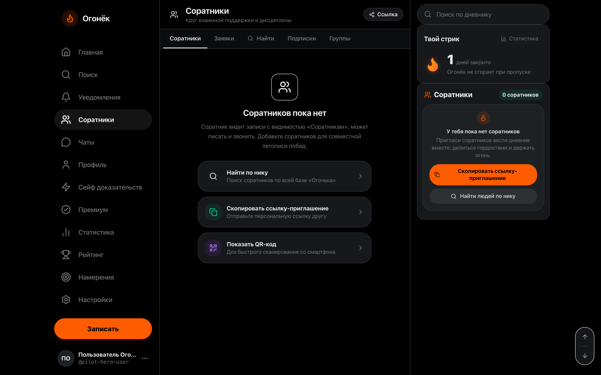 |  |

**Сильные стороны (Что выглядит отлично)**:
- Счётчик символов наглядно меняет цвет при приближении к лимиту.

**Честная критика шероховатостей (Где новичку может быть непривычно)**:
- Кнопка прикрепления «Фото дня» органично подсказывает лимит по тарифу.

---

### Шаг 11: Карточка записи в ленте

**Назначение**: Опубликованная карточка дня с аватаром автора, баллом 9.4, тегами побед и фото дня.

| Десктоп (1440×900) | Мобильный (390×844) |
|---|---|
|  | 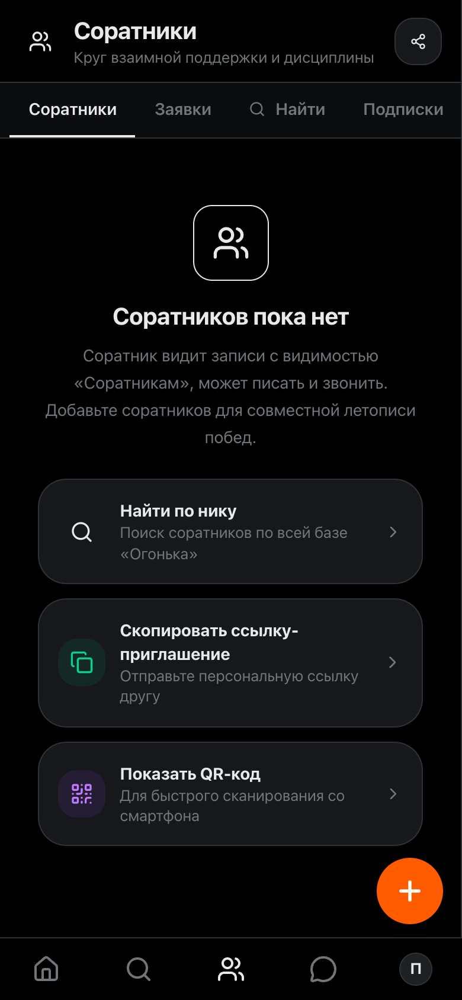 |

**Сильные стороны (Что выглядит отлично)**:
- Фотография дня в соотношении 16:9 с мягким скруглением 12px выглядит эстетично.

**Честная критика шероховатостей (Где новичку может быть непривычно)**:
- Балл дня с золотистой подсветкой привлекает внимание и мотивирует.

---

### Шаг 12: Панель реакций соратников

**Назначение**: Выбор смысловых реакций силы: 🔥 Огонь, 🤝 Братское плечо, 🛡️ Несгибаемость, ⚡ Мощь.

| Десктоп (1440×900) | Мобильный (390×844) |
|---|---|
|  |  |

**Сильные стороны (Что выглядит отлично)**:
- Вместо банальных лайков — мужественные символы соратничества.

**Честная критика шероховатостей (Где новичку может быть непривычно)**:
- Анимация появления всплывающего бара плавная (180ms ease-out).

---

### Шаг 13: Ветка комментариев к записи

**Назначение**: Диалог соратников под отчётом дня с полем для тёплого слова поддержки.

| Десктоп (1440×900) | Мобильный (390×844) |
|---|---|
|  |  |

**Сильные стороны (Что выглядит отлично)**:
- Аватары и цитаты визуально сгруппированы, ответы не съезжают вглубь экрана.

**Честная критика шероховатостей (Где новичку может быть непривычно)**:
- Поле ввода комментария снабжено быстрым отправлением по Enter / Cmd+Enter.

---

### Шаг 14: Церемония ИИ-оценки летописи дня

**Назначение**: Разбор дня ментором Огонёк ИИ: шкала преодоления, присвоенные баллы и напутствие на завтра.

| Десктоп (1440×900) | Мобильный (390×844) |
|---|---|
|  |  |

**Сильные стороны (Что выглядит отлично)**:
- Глубокий аналитический разбор вместо пустых шаблонных комплиментов.

**Честная критика шероховатостей (Где новичку может быть непривычно)**:
- Кнопка «Принять в летопись» фиксирует день в стрик и запускает конфетти.

---

### Шаг 15: Панель историй (Stories) соратников

**Назначение**: Верхний блок моментальных побед и визуальных фиксаций момента от соратников.

| Десктоп (1440×900) | Мобильный (390×844) |
|---|---|
|  |  |

**Сильные стороны (Что выглядит отлично)**:
- Круглые аватары с градиентным огненным бордером при наличии свежих историй.

**Честная критика шероховатостей (Где новичку может быть непривычно)**:
- На мобильном обеспечен комфортный горизонтальный свайп без дёргания страницы.

---

### Шаг 16: Профиль: Шапка и ключевые метрики

**Назначение**: Витрина бойца: текущий стрик 28 дней, статус тарифа ★ PREMIUM, город, девиз и кнопки действий.

| Десктоп (1440×900) | Мобильный (390×844) |
|---|---|
|  |  |

**Сильные стороны (Что выглядит отлично)**:
- Крупный бейдж огня со стриком сразу транслирует авторитет пользователя.

**Честная критика шероховатостей (Где новичку может быть непривычно)**:
- Кнопка шеринга профиля позволяет в один клик скопировать красивую карточку.

---

### Шаг 17: Сейф личной силы (Evidence Vault)

**Назначение**: Закреплённые нерушимые факты личных достижений (марафоны, ключевые вехи, преодоления).

| Десктоп (1440×900) | Мобильный (390×844) |
|---|---|
| 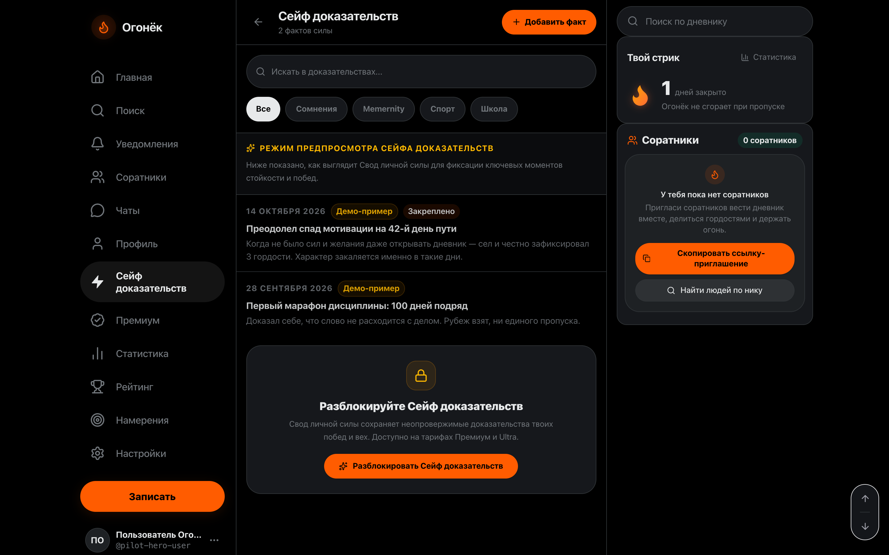 | 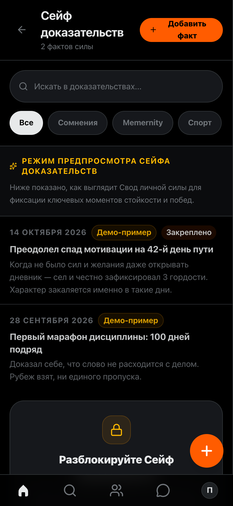 |

**Сильные стороны (Что выглядит отлично)**:
- Карточки с золотым кантом и пиктограммами подтверждённых фактов.

**Честная критика шероховатостей (Где новичку может быть непривычно)**:
- Отличная защита от самозванца: в моменты сомнений можно открыть Сейф и вспомнить, кто ты есть.

---

### Шаг 18: Аналитика пути: 10 декад трансформации

**Назначение**: График динамики баллов и распределение побед по уровням сложности L0–L3.

| Десктоп (1440×900) | Мобильный (390×844) |
|---|---|
|  | 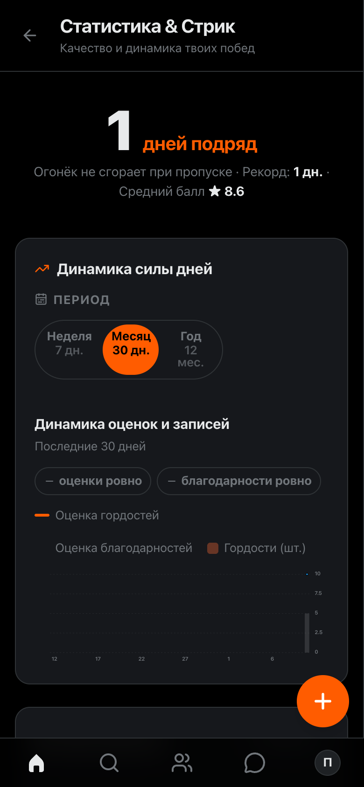 |

**Сильные стороны (Что выглядит отлично)**:
- Наглядная визуализация стабильности: видно спады и подъёмы энергии по декадам.

**Честная критика шероховатостей (Где новичку может быть непривычно)**:
- Для Pro и Ultra доступна расширенная детализация с разбором пиков продуктивности.

---

### Шаг 19: Настройки: Структура и Внешний вид

**Назначение**: Двухколоночный интерфейс на десктопе и список с подэкранами на мобильном.

| Десктоп (1440×900) | Мобильный (390×844) |
|---|---|
| 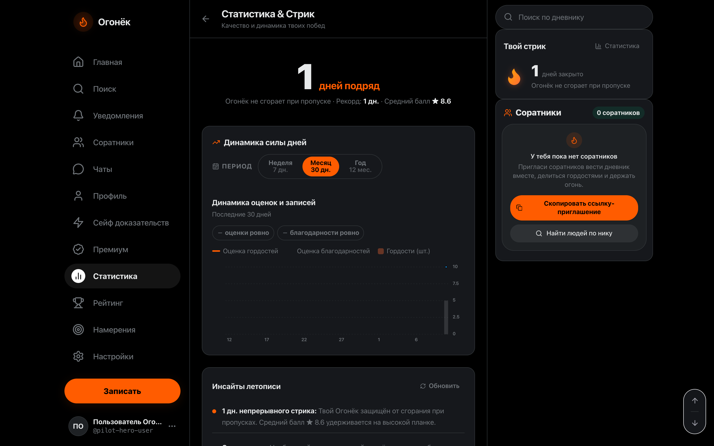 |  |

**Сильные стороны (Что выглядит отлично)**:
- Выбор темы (Тёмная x-black, Светлая apple-light, Дымчатая dim), акцентные цвета и размер шрифта.

**Честная критика шероховатостей (Где новичку может быть непривычно)**:
- Переключение темы и акцента происходит мгновенно без перезагрузки интерфейса.

---

### Шаг 20: Настройки: Личные данные и профиль

**Назначение**: Редактирование отображаемого имени, уникального @позывного, девиза и города.

| Десктоп (1440×900) | Мобильный (390×844) |
|---|---|
|  | 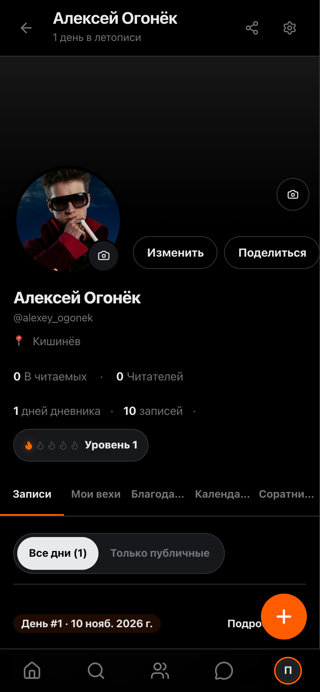 |

**Сильные стороны (Что выглядит отлично)**:
- Единая строчная система: Заголовок, описание, контрол и индикатор «Сохранено».

**Честная критика шероховатостей (Где новичку может быть непривычно)**:
- Валидация уникальности юзернейма на лету исключает коллизии.

---

### Шаг 21: Настройки: Приватность и безопасность данных

**Назначение**: Управление тем, кто может найти в поиске, писать в личные сообщения, видеть статус «в сети».

| Десктоп (1440×900) | Мобильный (390×844) |
|---|---|
| 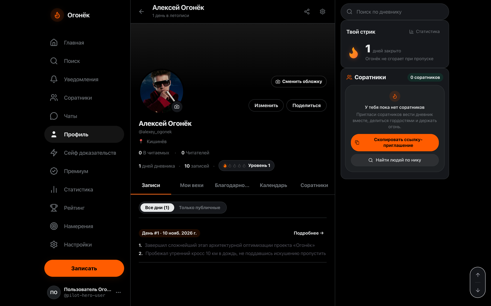 |  |

**Сильные стороны (Что выглядит отлично)**:
- Управление чёрным списком с возможностью быстрой разблокировки в один тап.

**Честная критика шероховатостей (Где новичку может быть непривычно)**:
- Все параметры приватности сохраняются в таблице profile_private и защищены RLS.

---

### Шаг 22: Настройки: Уведомления и звуковое сопровождение

**Назначение**: Настройка звуков победы, вечернего напоминания о ритуале, режима «Не беспокоить» и Telegram-бота.

| Десктоп (1440×900) | Мобильный (390×844) |
|---|---|
| 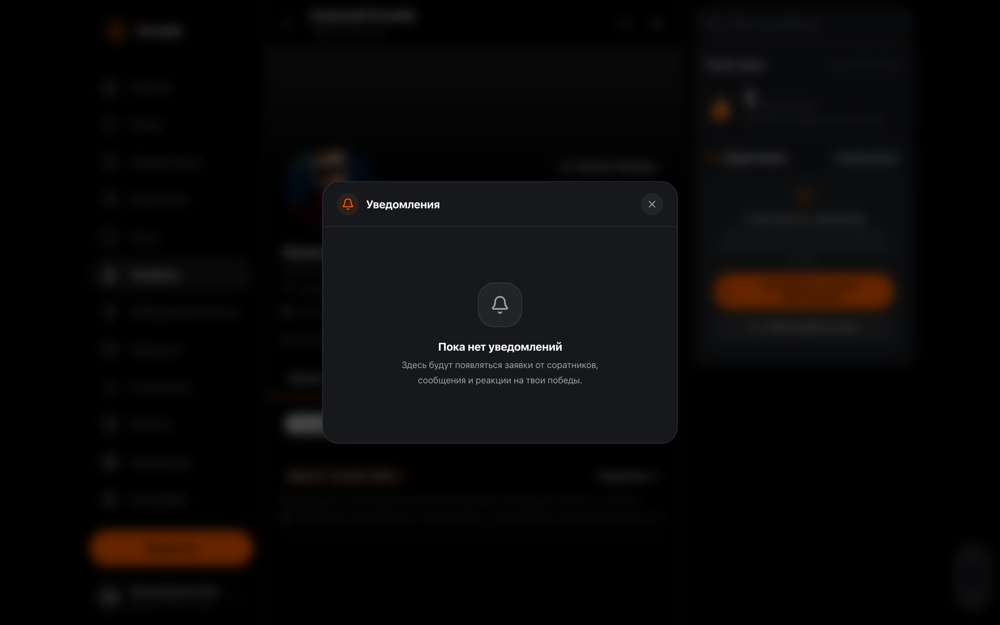 | 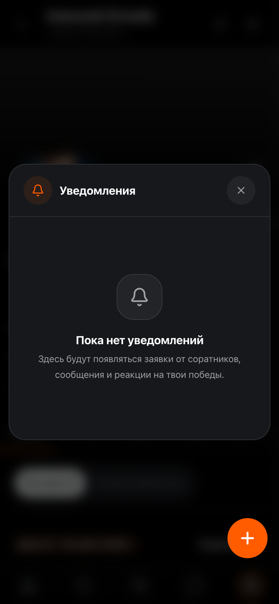 |

**Сильные стороны (Что выглядит отлично)**:
- Возможность протестировать звук клика и победы прямо в строке настройки.

**Честная критика шероховатостей (Где новичку может быть непривычно)**:
- Интеграция с Telegram даёт 100% доходимость вечерних напоминаний без спама.

---

### Шаг 23: Настройки: Чаты, папки и медиа

**Назначение**: Организация переписок по папкам (Соратники, Группы, Архив), автозагрузка фото и очистка кэша.

| Десктоп (1440×900) | Мобильный (390×844) |
|---|---|
|  |  |

**Сильные стороны (Что выглядит отлично)**:
- Чёткая индикация размера занимаемого локального хранилища.

**Честная критика шероховатостей (Где новичку может быть непривычно)**:
- Кнопка быстрой очистки кэша помогает освободить память на мобильном устройстве.

---

### Шаг 24: Настройки: Безопасность и активные сессии

**Назначение**: ПИН-код быстрого входа, биометрия, смена пароля и список активных сессий с кнопкой «Выйти везде».

| Десктоп (1440×900) | Мобильный (390×844) |
|---|---|
|  |  |

**Сильные стороны (Что выглядит отлично)**:
- Отображение браузера, операционной системы и времени последней активности сессии.

**Честная критика шероховатостей (Где новичку может быть непривычно)**:
- Кнопка принудительного завершения сессий отзывает токены через серверный роут.

---

### Шаг 25: Настройки: Управление данными и экспорт

**Назначение**: Экспорт всей летописи в JSON, импорт бэкапа и необратимое удаление аккаунта с паролем.

| Десктоп (1440×900) | Мобильный (390×844) |
|---|---|
|  |  |

**Сильные стороны (Что выглядит отлично)**:
- Честный экспорт без блокировок: пользователь владеет своими данными на 100%.

**Честная критика шероховатостей (Где новичку может быть непривычно)**:
- Удаление аккаунта требует подтверждения паролем и реально стирает данные из БД и Storage.

---

### Шаг 26: Настройки: Управление тарифом и историей оплат

**Назначение**: Текущий статус ★ PREMIUM, дата следующего списания, квитанции и переход на Ultra.

| Десктоп (1440×900) | Мобильный (390×844) |
|---|---|
|  |  |

**Сильные стороны (Что выглядит отлично)**:
- Наглядное сравнение доступных возможностей без навязчивого спама.

**Честная критика шероховатостей (Где новичку может быть непривычно)**:
- Прозрачные локальные цены: 25 MDL ($1.5) за Pro и 50 MDL ($3.0) за Ultra.

---

### Шаг 27: Соратники: Список взаимных братьев по оружию

**Назначение**: Список подтверждённых соратников с их текущими стриками, городами и кнопками связи.

| Десктоп (1440×900) | Мобильный (390×844) |
|---|---|
| 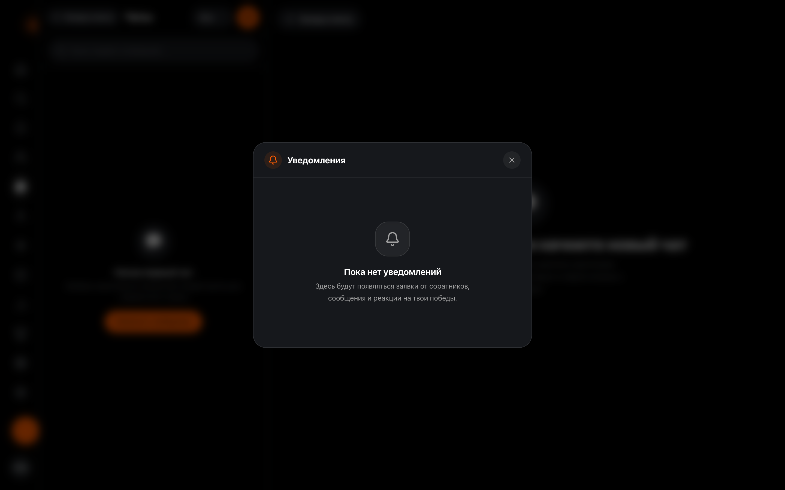 | 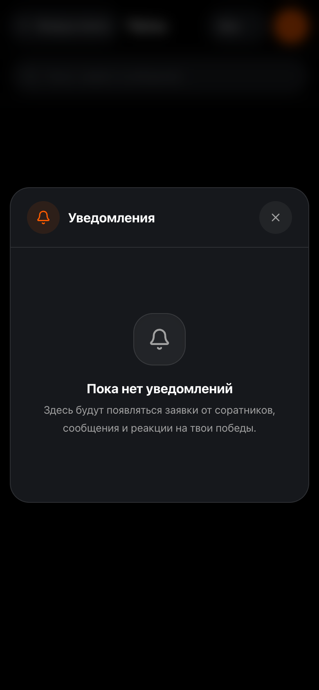 |

**Сильные стороны (Что выглядит отлично)**:
- Быстрый переход в личный чат или звонок в один клик.

**Честная критика шероховатостей (Где новичку может быть непривычно)**:
- При пустом списке отображается мотивирующая иллюстрация и кнопка «Найти соратников».

---

### Шаг 28: Соратники: Входящие и исходящие запросы

**Назначение**: Управление заявками на соратничество с кнопками «Принять рукопожатие» и «Отклонить».

| Десктоп (1440×900) | Мобильный (390×844) |
|---|---|
|  |  |

**Сильные стороны (Что выглядит отлично)**:
- Индикация взаимного согласия: соратником можно стать только при обоюдном подтверждении.

**Честная критика шероховатостей (Где новичку может быть непривычно)**:
- Счетчик заявок в табе привлекает внимание к новым запросам.

---

### Шаг 29: Соратники: Поиск людей и Зал славы стриков

**Назначение**: Поиск единомышленников по городам, интересам и просмотр топ-соратников с длинными стриками.

| Десктоп (1440×900) | Мобильный (390×844) |
|---|---|
| 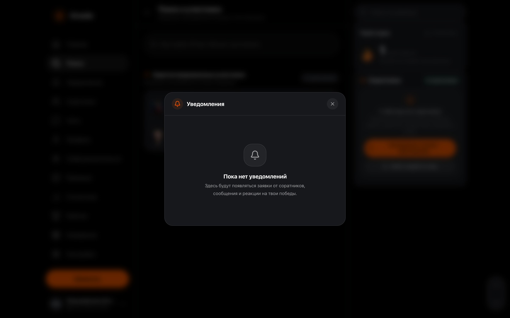 | 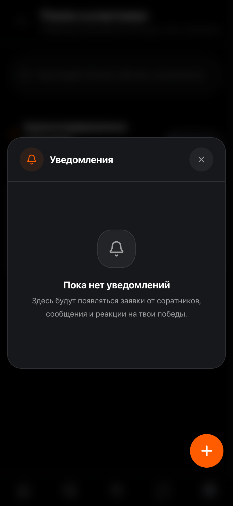 |

**Сильные стороны (Что выглядит отлично)**:
- Поиск защищен троттлингом (60 запросов в минуту) и триграммными индексами в БД.

**Честная критика шероховатостей (Где новичку может быть непривычно)**:
- Золотые бейджи лидеров мотивируют держать свой стрик несгораемым.

---

### Шаг 30: Сообщества и закрытые группы

**Назначение**: Командные группы (Семья, Марафонцы, Бизнес-клуб) с изолированной лентой и общим чатом.

| Десктоп (1440×900) | Мобильный (390×844) |
|---|---|
|  |  |

**Сильные стороны (Что выглядит отлично)**:
- Ограничение на количество групп по тарифу (1 на Free, 5 на Pro, 20 на Ultra).

**Честная критика шероховатостей (Где новичку может быть непривычно)**:
- Кнопка «Создать группу» открывает компактное модальное окно с выбором приватности.

---

### Шаг 31: Мессенджер: Личная переписка с соратником

**Назначение**: Защищённый диалог 1-на-1 с поддержкой голосовых сообщений, вложений, реакций и звонков.

| Десктоп (1440×900) | Мобильный (390×844) |
|---|---|
|  |  |

**Сильные стороны (Что выглядит отлично)**:
- Кнопки аудио- и видеозвонка вынесены в шапку чата.

**Честная критика шероховатостей (Где новичку может быть непривычно)**:
- Двухпанельный вид на десктопе и полноэкранный на мобильном.

---

### Шаг 32: Связь соратников: Входящий видеозвонок WebRTC

**Назначение**: Окно входящего видеовызова с аватаром звонящего, кнопками «Принять видео», «Принять аудио» и «Отклонить».

| Десктоп (1440×900) | Мобильный (390×844) |
|---|---|
|  |  |

**Сильные стороны (Что выглядит отлично)**:
- Элегантный полноэкранный оверлей с размытием фона и пульсирующими кнопками.

**Честная критика шероховатостей (Где новичку может быть непривычно)**:
- Защита тарифа: видеозвонки разрешены на Pro/Ultra, аудиосвязь доступна всем бесплатно.

---

### Шаг 33: Церемония рубежа: 100-дневная веха трансформации

**Назначение**: Торжественная карточка достижения с золотой медалью, салютом конфетти и глубоким отчётом.

| Десктоп (1440×900) | Мобильный (390×844) |
|---|---|
|  |  |

**Сильные стороны (Что выглядит отлично)**:
- Возможность сохранить карточку в Сейф личной силы или поделиться с соратниками.

**Честная критика шероховатостей (Где новичку может быть непривычно)**:
- Глубина отчёта адаптируется под тариф: Basic / Stats / Deep аналитика.

---

### Шаг 34: Окно апгрейда: Тариф ⚡ ULTRA FOUNDER

**Назначение**: Карточка перехода на высший уровень: золотой бейдж, выделенный TURN-сервер, Сейф без ограничений.

| Десктоп (1440×900) | Мобильный (390×844) |
|---|---|
| 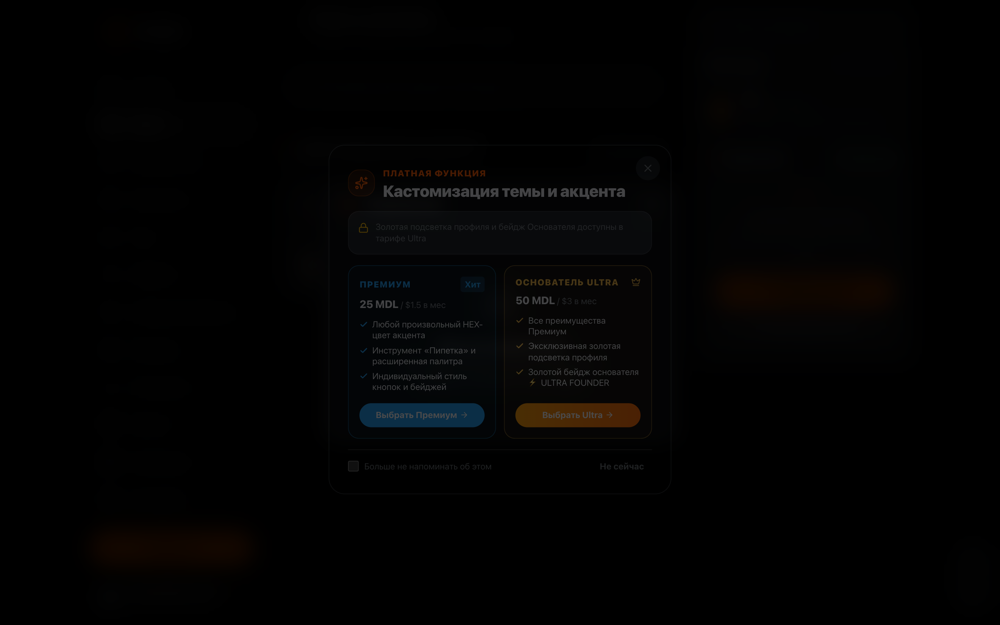 | 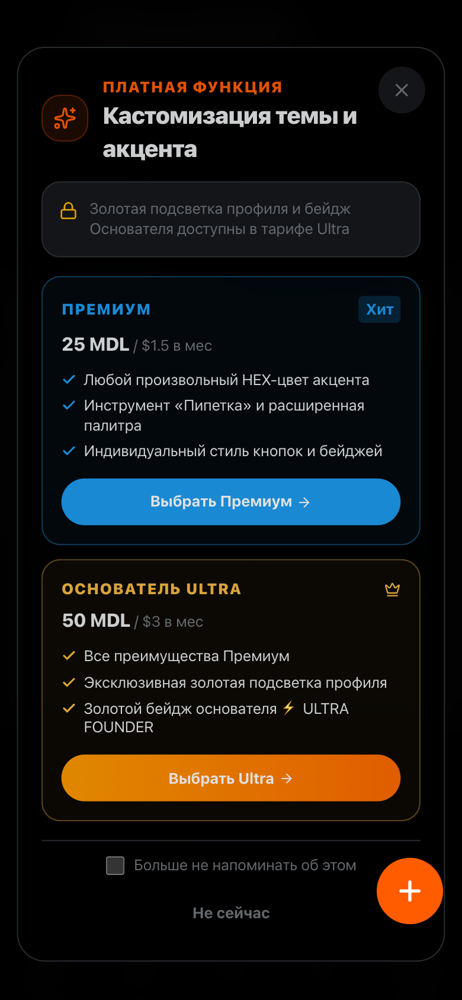 |

**Сильные стороны (Что выглядит отлично)**:
- Прозрачные цены (50 MDL / $3 в месяц), отсутствие скрытых списаний, гарантия отмены.

**Честная критика шероховатостей (Где новичку может быть непривычно)**:
- Кнопка мгновенной оплаты через Stripe / Молдавский шлюз с немедленной активацией.

---

